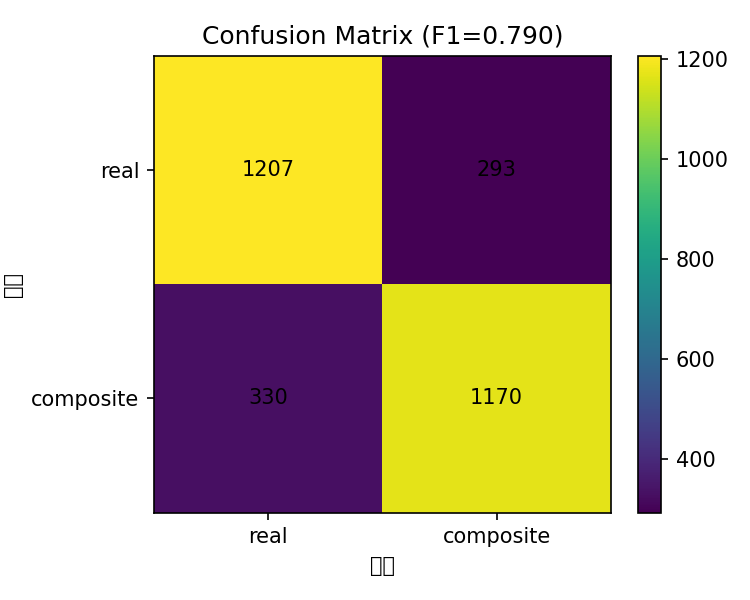
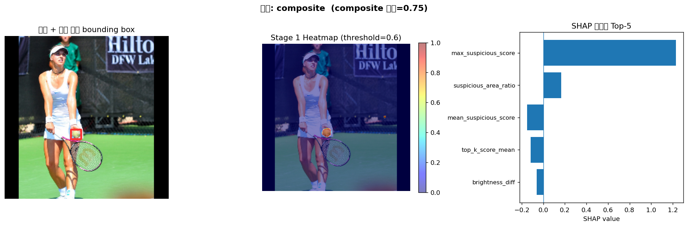
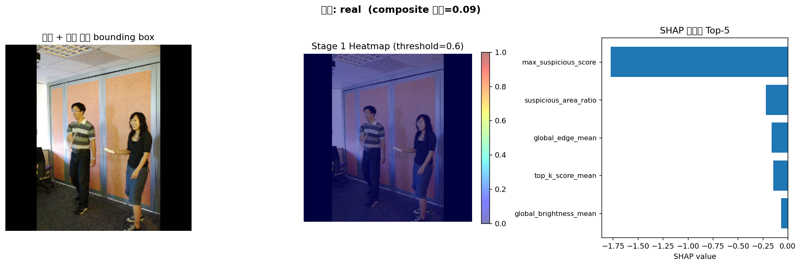
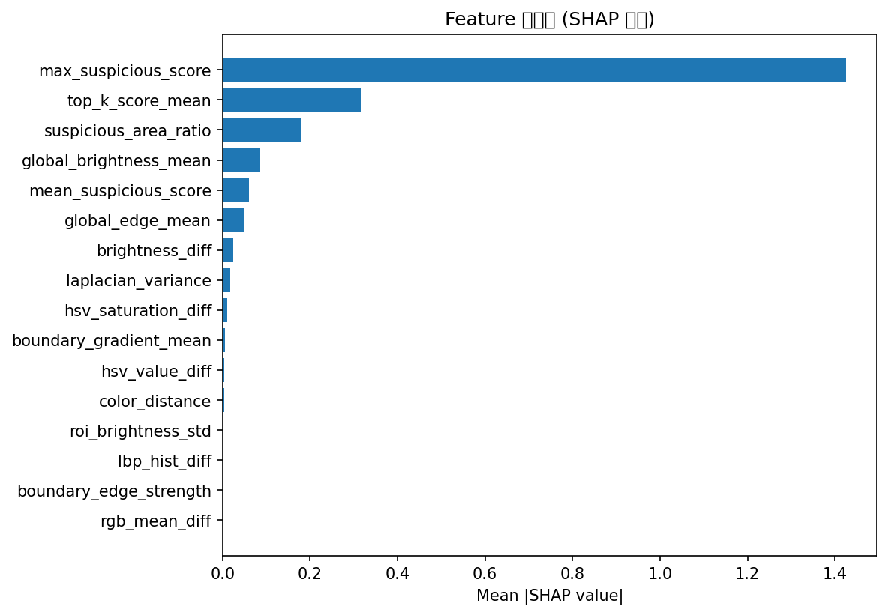

### U-Net & LightGBM 기반 이미지 조작 탐지 프로젝트

이미지의 조작 여부를 판별하고, 조작이 의심되는 영역을 시각화하는 AI 기반 이미지 포렌식 팀 프로젝트입니다.

U-Net을 이용해 이미지 내 조작 의심 영역을 탐지하고, 해당 영역에서 추출한 특징을 LightGBM으로 분석하여 최종적으로 이미지의 조작 여부를 분류합니다.

**My Role: Data Preprocessing (데이터 전처리 담당)**

## 1. Project Overview

| 항목 | 내용 |
|---|---|
| 프로젝트 유형 | AI 이미지 포렌식 팀 프로젝트 |
| 개발 환경 | Python, Google Colab |
| 주요 기술 | PyTorch, U-Net, EfficientNet-B4, LightGBM, SHAP |
| 데이터셋 | DEFACTO, COCO |
| 전체 데이터 | 30,000장 |
| 담당 역할 | 데이터 전처리 및 데이터셋 구성 |

### Project Objectives

- 실제 이미지와 조작 이미지를 구분하는 AI 모델 개발
- 이미지에서 조작이 의심되는 영역 탐지
- 이미지 특징을 활용한 조작 여부 분류
- SHAP 분석을 통한 모델 판단 근거 시각화

## 2. My Contributions — Data Preprocessing

팀 프로젝트에서 데이터 전처리를 담당했습니다.

모델 학습에 필요한 데이터를 정리하고, 실제 이미지와 조작 이미지가 일관된 형식으로 사용될 수 있도록 데이터셋을 구성했습니다.

### 2.1 데이터셋 구성

두 종류의 이미지 데이터셋을 사용했습니다.

| Dataset | Label | Images |
|---|---|---:|
| COCO | Real (0) | 15,000 |
| DEFACTO | Composite (1) | 15,000 |
| **Total** | | **30,000** |

COCO 데이터는 실제 이미지로, DEFACTO 데이터는 조작 이미지로 사용했습니다.

각 이미지에 대응하는 마스크 경로와 라벨 정보를 관리하고, 두 데이터셋을 하나의 CSV 파일로 통합했습니다.

### 2.2 데이터 경로 및 형식 정리

데이터셋마다 이미지와 마스크의 저장 경로가 달라 학습 과정에서 파일을 정상적으로 불러올 수 있도록 경로를 정리했습니다.

주요 작업은 다음과 같습니다.

- ZIP 파일 압축 해제 및 데이터셋 구조 확인
- 이미지 및 마스크 파일 경로 정리
- Windows와 Colab 환경의 경로 차이 처리
- 이미지 라벨 및 필수 컬럼 확인
- Pandas를 이용한 데이터 통합
- 최종 `dataset.csv` 생성

### 2.3 Train / Validation / Test 구성

모델 학습과 성능 평가를 위해 데이터를 세 부분으로 구성했습니다.

| Dataset | Real | Composite | Total |
|---|---:|---:|---:|
| Train | 10,500 | 10,500 | 21,000 |
| Validation | 3,000 | 3,000 | 6,000 |
| Test | 1,500 | 1,500 | 3,000 |
| **Total** | **15,000** | **15,000** | **30,000** |

각 데이터 분할에서 실제 이미지와 조작 이미지의 개수가 동일하도록 구성했습니다.

### 2.4 데이터 검증

데이터 전처리 과정에서는 학습에 영향을 줄 수 있는 오류를 확인하는 작업도 진행했습니다.

- 이미지 및 마스크 파일 존재 여부 확인
- 라벨 값 검증
- 중복 이미지 경로 확인
- `group_id`를 활용한 데이터 분할 간 중복 검사
- 데이터 분할별 이미지 개수 검증

특히 동일한 그룹의 데이터가 서로 다른 분할에 포함되는 문제를 확인할 수 있도록 검증 로직을 구성했습니다.

이를 통해 모델 학습 전에 데이터의 구조와 일관성을 확인할 수 있도록 했습니다.

**관련 코드:** `src/step01_data_prep.py`

## 3. Model Architecture

본 프로젝트는 두 단계로 구성된 이미지 조작 탐지 구조를 사용했습니다.

**Stage 1 — U-Net + EfficientNet-B4**

입력 이미지에서 조작이 의심되는 영역을 탐지하고 Heatmap을 생성합니다.

**Stage 2 — LightGBM**

Heatmap에서 추출한 밝기, 색상, 경계 및 의심 영역 관련 특징을 활용하여 실제 이미지와 조작 이미지를 분류합니다.

최종적으로 SHAP을 활용해 모델의 판단에 영향을 준 특징을 분석했습니다.

## 4. Experimental Results

3,000장의 테스트 데이터를 사용한 팀 프로젝트의 최종 평가 결과입니다.

| Metric | Result |
|---|---:|
| Accuracy | 79.23% |
| Precision | 79.97% |
| Recall | 78.00% |
| F1-score | 0.790 |

### Confusion Matrix



실제 이미지 1,500장 중 1,207장, 조작 이미지 1,500장 중 1,170장을 올바르게 분류했습니다.

### Forgery Detection Examples



조작 이미지에 대한 예측 결과, Stage 1 Heatmap, SHAP 특징 기여도를 함께 시각화한 예시입니다.



실제 이미지에 대한 분류 결과와 판단 근거를 시각화한 예시입니다.

### Feature Importance (SHAP)



SHAP 분석 결과, `max_suspicious_score`가 최종 분류에 가장 큰 영향을 주는 특징으로 나타났습니다.

## 5. Project Structure

```text
Image-Forensics-Detection/
├── codes/
│   └── Experimental notebooks
├── src/
│   ├── step00_setup.py
│   ├── step01_data_prep.py
│   ├── step02_train_stage1.py
│   ├── step03_heatmap_features.py
│   ├── step04_train_stage2.py
│   ├── step05_evaluate.py
│   └── utils.py
├── results/
│   ├── best_config.json
│   ├── cv_results.csv
│   ├── shap_importance.csv
│   ├── stage1_training_log.json
│   ├── test_metrics.json
│   └── visualizations/
├── forensic_colab_runner.ipynb
└── README.md
```

## 6. Development Environment

- Python
- Google Colab
- Google Drive
- Pandas / NumPy
- OpenCV
- PyTorch
- Segmentation Models PyTorch
- LightGBM
- Scikit-learn
- SHAP
- Matplotlib

### Execution

프로젝트는 Google Colab 환경을 기준으로 구성되었습니다.

최상위의 `forensic_colab_runner.ipynb`에서 실행 흐름을 확인할 수 있으며, 각 단계의 구현 코드는 `src/` 폴더에 정리했습니다.

실행 시 데이터셋과 학습된 모델 파일이 별도로 필요하며, Google Drive 경로 설정을 사용 환경에 맞게 수정해야 합니다.
